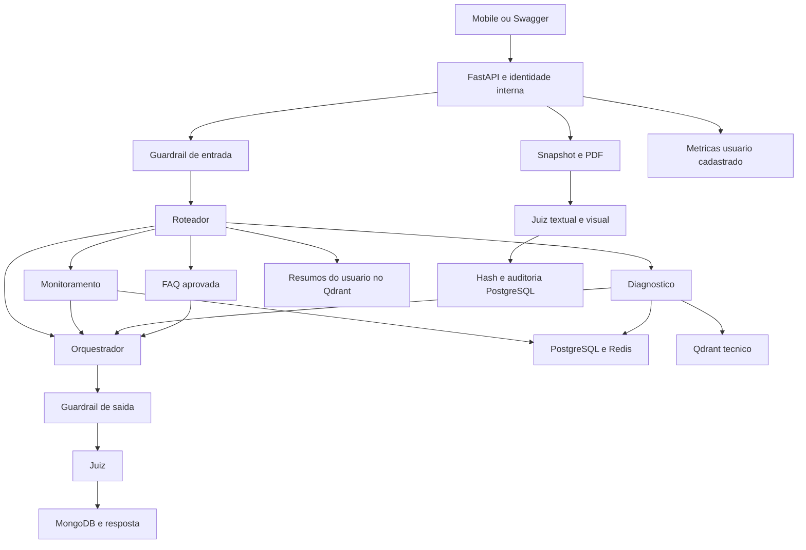

# Trimmy: arquitetura e checklist de entrega

Revisão do código e das decisões desta conversa. API local, dados de teste,
autenticação JWT compatível com o backend principal. Commits locais; sem push ou publicação.

## Checklist

| Demanda | Situação | Evidência e limite |
| --- | --- | --- |
| API FastAPI | Implementada | `app/main.py`, quatro endpoints e schemas Pydantic. |
| Pelo menos cinco agentes | Implementada | Roteador, monitoramento, diagnóstico, FAQ, orquestrador e juiz: seis papéis. Memória é infraestrutura/tool. |
| LangChain e LangGraph | Implementados | Modelos reutilizados, tools por domínio e grafo compilado uma vez. |
| Conversas e sessões | Implementadas | MongoDB, uma sessão ativa por usuário, contexto das últimas 20 mensagens e persistência após validação. |
| Memória de longo prazo | Implementada | Resumo ao encerrar sessão, Qdrant e até três resumos do próprio usuário. |
| Monitoramento | Implementado | Cadastro, limites, uma/todas as câmaras, últimas leituras e alertas permitidos. Última leitura não confirma condição atual. |
| Diagnóstico com RAG | Implementado | Oito regras aprovadas, requisitos, fontes e referências conferidos no backend. Sem confirmação de defeitos. |
| Fonte externa | Implementada | Fontes técnicas oficiais documentadas nas regras aprovadas. URLs não são buscadas durante o chat. |
| FAQ | Implementada | Somente textos da base aprovada; detalhes ausentes não são inventados. |
| Orquestração | Implementada | Roteador escolhe domínio; orquestrador apresenta o resultado. Sem tools no orquestrador. |
| Guardrails de entrada/saída | Implementados | Recusas determinísticas e mascaramento de padrões reconhecidos de dados sensíveis. |
| Juiz por LLM | Implementado | Notas, schema e IDs de fontes validados. Falha nunca aprova automaticamente. |
| Relatórios PDF | Implementados; homologação real parcial | Snapshot, cálculos, design, julgamento de todas as páginas, hash e auditoria. Cotas podem impedir download. |
| Observabilidade persistida | Implementada | MongoDB, latências, tokens, erros, projeções para 100/1000 usuários e acesso com usuário cadastrado. |
| Custo por resolução | Implementado | Custo dos turnos / turnos concluídos e aprovados. Resolução técnica da interação, não de um alerta. |
| ROI | Fórmula implementada; premissas reais pendentes | Economia estimada por tempo manual evitado e custo/hora configuráveis. Sem salário ou benefício inventado. |
| Desenho da arquitetura | Documentado | Diagrama abaixo, consistente com o fluxo atual. |
| Testes unitários | Implementados e ampliados | Mock/MagicMock, preparação, execução e asserts diretos. Sem serviços reais na suíte unitária. |
| Integrações reais | Verificação separada | PostgreSQL, Redis, MongoDB, Qdrant, Gemini e Groq; execução opt-in. Conectividade não comprova qualidade semântica. |
| Perguntas reais/rapidez | Em avaliação controlada | Resultados no acompanhamento. Registra-se também falha; não se considera uma pergunta não executada como aprovada. |
| Integração mobile/backend | Pendente | Consumir contratos abaixo e encerrar sessão no aplicativo. Repositórios externos não alterados. |
| Autenticação real | Implementada; validação com login real pendente | JWT assinado pelo backend, assinatura/expiração verificadas e username resolvido no banco. Requer a mesma SECURITY_KEY. |
| Observabilidade sem restrição de cargo | Implementada | Todos os perfis cadastrados podem consultar, com cabeçalho Bearer. |
| MCP/A2A | Pendente de definição | Nenhum protocolo externo implementado. Definir consumidor, necessidade e acesso antes de adicionar serviço. |
| Retenção/tamanho de sessões | Pendente de política | Mensagens preservadas; definir retenção/rotação antes de uso prolongado. Não apagar histórico silenciosamente. |
| Predição, reparos e ações automáticas | Fora do escopo | Predição removida. Não recriar treinamento ou tools de escrita operacional. |

## Estrutura e padrão do Assessor

São preservados `main.py`, `routes/`, `schemas.py`, `graph.py`, `prompts.py`,
`llms.py`, `memory.py`, `vectorstore.py` e `tools/`. Tools usam `@tool`, Pydantic,
lista `TOOLS` e PostgreSQL por `get_conn()`. Não são reutilizadas regras financeiras.
Identidade e acesso vêm do backend. Apresentação determinística evita uma geração
extra para reescrever temperaturas, status e hipóteses já validados.



## Contratos e permissões

- `POST /chat`: `{"token":"JWT_DO_LOGIN","mensagem":"Qual a temperatura da câmara 3?"}`.
- `POST /chat/encerrar`: `{"token":"JWT_DO_LOGIN"}`; resume e indexa a sessão.
- `POST /relatorios/pdf`: token, datas e seleção de CD/câmara. ADMIN, GESTOR e
  OPERADOR no próprio CD; SUPER_ADMIN com CD informado.
- `GET /observabilidade`: `Authorization: Bearer JWT_DO_LOGIN`; usuário cadastrado de qualquer perfil.

SUPER_ADMIN consulta câmaras globalmente; os demais perfis ficam no próprio CD.
Alertas do chat são ativos permitidos ou reconhecidos pelo próprio usuário;
OPERADOR mantém o filtro de nível OPERADOR. Relatório inclui todos os status
do CD/período autorizado. Justificativas pertencem ao alerta autorizado.

Não existe usuário fixo nem bypass. Configure `SECURITY_KEY` com o mesmo valor
do backend, sem codificação Base64 adicional. O backend usa `sub=username`,
`iat` e `exp`, assinatura HMAC em UTF-8 pelo JJWT. A Trimmy fixa HS256/HS384/HS512
conforme os 32/48/64 bytes mínimos da chave, como o emissor, sem aceitar o
algoritmo indicado pelo cliente como decisão de confiança. Tokens inválidos,
expirados e de usuário excluído retornam 401; a ausência de chave válida retorna
503. Permissões e CD continuam vindo do PostgreSQL, não de claims do token.
Reinicie o Uvicorn após alterar configuração.
O aplicativo deve chamar explicitamente `/chat/encerrar` para gerar o resumo.

Contrato conferido em `main` dos repositórios do grupo:
`2_ano_backend/TokenProvider.java`, `UserDetailsServiceImpl.java` e `UserController.java`.
O login é `POST /auth/login` com `username` e `senha`; a resposta contém `token`,
`expirationTime` e `validUntil`. O mobile em `main` ainda possui TODO de chamada
ao login em `LoginActivity.java` e resposta simulada em `TrimmyActivity.java`.
Esses repositórios não foram modificados. Para testar no Swagger da Trimmy,
copie o campo `token` da resposta real do login, sem o prefixo Bearer nos corpos
JSON; em `Authorize`, informe apenas o JWT. `teste` deixou de ser um token válido.

## Verificação e limites

```powershell
python -m pytest tests -m "not integration" -q
ruff check .
```

Integrações reais são opt-in por `SKADI_RUN_INTEGRATION_TESTS=true`.
ROI usa `ROI_TEMPO_MANUAL_MINUTOS` e `ROI_CUSTO_HORA_USD`, sem valores padrão.
As projeções consideram uma interação semanal por usuário e preços estimados
de referência; não afirmam cobrança efetiva ou economia comprovada.

Especialistas e juiz usam timeout de 30 segundos por chamada e zero retries
automáticos do SDK; agentes têm até 25 passos. São limites de execução, não de
sensores. Cada geração de PDF usa uma chamada multimodal para todas as páginas.
