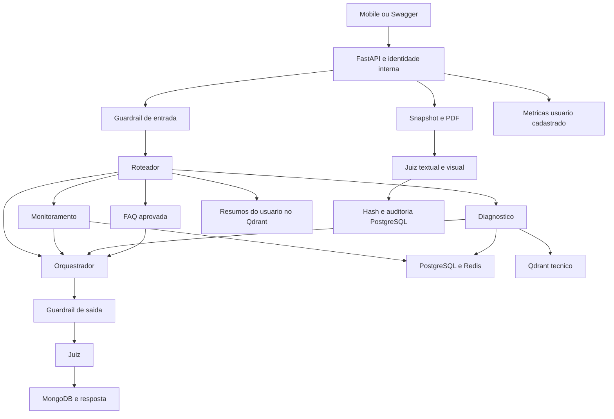

# Trimmy: arquitetura e checklist de entrega

Revisão do código e das decisões desta conversa. API local, dados de teste,
autenticação JWT compatível com o backend principal. Commits locais; sem push ou publicação.

## Checklist

| Demanda | Situação | Evidência e limite |
| --- | --- | --- |
| API FastAPI | Implementada | `app/main.py`, quatro endpoints e schemas Pydantic. |
| Pelo menos cinco agentes | Implementada | Roteador, monitoramento, diagnóstico, FAQ, orquestrador e juiz: seis papéis. Memória é infraestrutura/tool. |
| LangChain e LangGraph | Implementados | Modelos reutilizados, tools por domínio e grafo compilado uma vez. |
| Conversas e sessões | Implementadas | MongoDB, uma sessão ativa por usuário, contexto das últimas 20 mensagens e persistência após validação. |
| Memória de longo prazo | Implementada | Resumo ao encerrar sessão, Qdrant e até três resumos do próprio usuário. |
| Monitoramento | Implementado | Cadastro, limites, uma/todas as câmaras, últimas leituras e alertas permitidos. Última leitura não confirma condição atual. |
| Diagnóstico com RAG | Implementado | Oito regras aprovadas, requisitos, fontes e referências conferidos no backend. Sem confirmação de defeitos. |
| Fonte externa | Implementada | Fontes técnicas oficiais documentadas nas regras aprovadas. URLs não são buscadas durante o chat. |
| FAQ | Implementada | Somente textos da base aprovada; detalhes ausentes não são inventados. |
| Orquestração | Implementada | Roteador escolhe domínio; orquestrador apresenta o resultado. Sem tools no orquestrador. |
| Guardrails de entrada/saída | Implementados | Recusas determinísticas e mascaramento de padrões reconhecidos de dados sensíveis. |
| Juiz por LLM | Implementado | Notas, schema e IDs de fontes validados. Falha nunca aprova automaticamente. |
| Relatórios PDF | Implementados; homologação real parcial | Snapshot, cálculos, design, julgamento de todas as páginas, hash e auditoria. Cotas podem impedir download. |
| Observabilidade persistida | Implementada | MongoDB, latências, tokens, erros, projeções para 100/1000 usuários e acesso com usuário cadastrado. |
| Custo por resolução | Implementado | Custo dos turnos / turnos concluídos e aprovados. Resolução técnica da interação, não de um alerta. |
| ROI | Implementado com cenário acadêmico | Premissas locais: 5 minutos e US$ 5/hora, explicitamente ilustrativas. Valores reais ainda exigem medição. |
| Desenho da arquitetura | Documentado | Diagrama abaixo, consistente com o fluxo atual. |
| Testes unitários | Implementados e ampliados | Mock/MagicMock, preparação, execução e asserts diretos. Sem serviços reais na suíte unitária. |
| Integrações reais | Verificação separada | PostgreSQL, Redis, MongoDB, Qdrant, Gemini e Groq; execução opt-in. Conectividade não comprova qualidade semântica. |
| Perguntas reais/rapidez | Em avaliação controlada | Resultados no acompanhamento. Registra-se também falha; não se considera uma pergunta não executada como aprovada. |
| Integração mobile/backend | Pendente | Consumir contratos abaixo e encerrar sessão no aplicativo. Repositórios externos não alterados. |
| Autenticação real | Implementada; validação com login real pendente | JWT assinado pelo backend, assinatura/expiração verificadas e username resolvido no banco. Requer a mesma SECURITY_KEY. |
| Observabilidade sem restrição de cargo | Implementada | Todos os perfis cadastrados podem consultar, com cabeçalho Bearer. |
| MCP/A2A | Pendente de definição | Nenhum protocolo externo implementado. Definir consumidor, necessidade e acesso antes de adicionar serviço. |
| Retenção/tamanho de sessões | Pendente de política | Mensagens preservadas; definir retenção/rotação antes de uso prolongado. Não apagar histórico silenciosamente. |
| Predição, reparos e ações automáticas | Fora do escopo | Predição removida. Não recriar treinamento ou tools de escrita operacional. |

## Estrutura e padrão do Assessor

São preservados `main.py`, `routes/`, `schemas.py`, `graph.py`, `prompts.py`,
`llms.py`, `memory.py`, `vectorstore.py` e `tools/`. Tools usam `@tool`, Pydantic,
lista `TOOLS` e PostgreSQL por `get_conn()`. Não são reutilizadas regras financeiras.
Identidade e acesso vêm do backend. Apresentação determinística evita uma geração
extra para reescrever temperaturas, status e hipóteses já validados.



## Contratos e permissões

- `POST /chat`: `{"token":"JWT_DO_LOGIN","mensagem":"Qual a temperatura da câmara 3?"}`.
- `POST /chat/encerrar`: `{"token":"JWT_DO_LOGIN"}`; resume e indexa a sessão.
- `POST /relatorios/pdf`: token, datas e seleção de CD/câmara. ADMIN, GESTOR e
  OPERADOR no próprio CD; SUPER_ADMIN com CD informado.
- `GET /observabilidade`: `Authorization: Bearer JWT_DO_LOGIN`; usuário cadastrado de qualquer perfil.

SUPER_ADMIN consulta câmaras globalmente; os demais perfis ficam no próprio CD.
Alertas do chat são ativos permitidos ou reconhecidos pelo próprio usuário;
OPERADOR mantém o filtro de nível OPERADOR. Relatório inclui todos os status
do CD/período autorizado. Justificativas pertencem ao alerta autorizado.

Não existe usuário fixo nem bypass. Configure `SECURITY_KEY` com o mesmo valor
do backend, sem codificação Base64 adicional. O backend usa `sub=username`,
`iat` e `exp`, assinatura HMAC em UTF-8 pelo JJWT. A Trimmy fixa HS256/HS384/HS512
conforme os 32/48/64 bytes mínimos da chave, como o emissor, sem aceitar o
algoritmo indicado pelo cliente como decisão de confiança. Tokens inválidos,
expirados e de usuário excluído retornam 401; a ausência de chave válida retorna
503. Permissões e CD continuam vindo do PostgreSQL, não de claims do token.
Reinicie o Uvicorn após alterar configuração.
O aplicativo deve chamar explicitamente `/chat/encerrar` para gerar o resumo.

Contrato conferido em `main` dos repositórios do grupo:
`2_ano_backend/TokenProvider.java`, `UserDetailsServiceImpl.java` e `UserController.java`.
O login é `POST /auth/login` com `username` e `senha`; a resposta contém `token`,
`expirationTime` e `validUntil`. O mobile em `main` ainda possui TODO de chamada
ao login em `LoginActivity.java` e resposta simulada em `TrimmyActivity.java`.
Esses repositórios não foram modificados. Para testar no Swagger da Trimmy,
copie o campo `token` da resposta real do login, sem o prefixo Bearer nos corpos
JSON; em `Authorize`, informe apenas o JWT. `teste` deixou de ser um token válido.

## Verificação e limites

```powershell
python -m pytest tests -m "not integration" -q
ruff check .
```

Integrações reais são opt-in por `SKADI_RUN_INTEGRATION_TESTS=true`.
ROI usa `ROI_TEMPO_MANUAL_MINUTOS` e `ROI_CUSTO_HORA_USD`, sem valores padrão.
As projeções consideram uma interação semanal por usuário e preços estimados
de referência; não afirmam cobrança efetiva ou economia comprovada.

Especialistas e juiz usam timeout de 30 segundos por chamada e zero retries
automáticos do SDK; agentes têm até 25 passos. São limites de execução, não de
sensores. Cada geração de PDF usa uma chamada multimodal para todas as páginas.

## Complexidade do projeto e demonstração da demanda de IA

Esta seção consolida a justificativa técnica para a demanda acadêmica de
Inteligência Artificial. A complexidade está na coordenação entre linguagem
natural, consultas autorizadas, recuperação de conhecimento, memória e validação
da entrega. Quantidade de arquivos ou agentes, isoladamente, não demonstra essa
complexidade. Os mecanismos descritos abaixo correspondem ao código atual;
integrações pendentes não são apresentadas como concluídas.

### Problema atendido e divisão de responsabilidades

A Trimmy apoia funcionários no monitoramento de câmaras frigoríficas e na
interpretação assistida de ocorrências de temperatura. Perguntas semelhantes
podem exigir fontes diferentes: temperatura exige consulta operacional;
navegação no aplicativo exige FAQ; uma hipótese de causa exige evidências e
regras técnicas aprovadas. O sistema precisa escolher a fonte correta sem usar
uma conversa antiga como leitura atual ou transformar uma hipótese em defeito.

| Papel | Responsabilidade implementada | Por que é separado |
| --- | --- | --- |
| Roteador | Identifica o domínio e pode recuperar referências da memória. | Evita entregar uma pergunta operacional à FAQ ou responder sem consultar a fonte necessária. |
| Monitoramento | Consulta cadastro, limites, leituras e alertas permitidos por tools. | Valores e associações são obtidos dos bancos, não calculados pelo LLM. |
| Diagnóstico | Reúne evidências, justificativas e regras aprovadas; propõe uma análise validada no backend. | Uma regra recuperada não basta para concluir que seus requisitos estão atendidos. |
| FAQ | Seleciona respostas da base oficial do sistema. | Evita inventar funcionalidades, políticas, telas ou prazos de suporte. |
| Orquestrador | Entrega a resposta final a partir do pedido e do resultado do especialista. | Preserva os dados e ressalvas; resultados estruturados podem ter apresentação determinística. |
| Juiz | Avalia a candidata contra as evidências antes de entregá-la. | Uma geração plausível não é considerada suficiente para aprovação. |

Esses são seis papéis no fluxo, não seis serviços independentes. Alguns caminhos
usam respostas determinísticas para preservar resultados já validados. A memória
é infraestrutura e tool; o PDF é um serviço acionado por endpoint, não um agente
adicional. Essa distinção deve ser explicada na apresentação do requisito de
no mínimo cinco agentes, sem contar bancos ou guardrails como agentes.

LangChain integra os modelos, schemas e ferramentas. LangGraph representa o
estado e as transições entre guardrails, roteamento, especialista, orquestrador
e juiz. O grafo é compilado uma vez; os clientes dos modelos são reutilizados.
Isso reduz preparação repetida sem reutilizar uma leitura antiga como consulta
nova. A estrutura segue o Assessor: rotas, schemas, grafo, prompts, clientes,
memória e tools por domínio, adaptados às regras do Skadi.

### Integração de quatro armazenamentos com funções diferentes

| Componente | Papel na Trimmy | Cuidado necessário |
| --- | --- | --- |
| PostgreSQL | Usuários, permissões, câmaras, limites, histórico, alertas, justificativas e registro dos relatórios. | Aplicar escopo antes dos filtros, manter associações por ID e respeitar constraints e transações. |
| Redis | Últimas leituras disponíveis no Stream de temperatura. | Ausência de leitura não é zero; o horário retornado não comprova temperatura atual. |
| MongoDB | Sessões, mensagens e métricas de observabilidade. | Separar sessões dos usuários e salvar a resposta efetivamente entregue, sem persistir a candidata rejeitada como resposta. |
| Qdrant | Resumos de conversas e regras técnicas em coleções distintas. | Filtrar memória pelo usuário e conferir aprovação, versão e conteúdo das regras recuperadas. |

Um atendimento pode consultar mais de um componente, mas cada dado tem uma
origem definida. A memória ajuda a compreender referências como “consulte”;
não concede permissões, não aprova regras e não substitui a consulta operacional.
As últimas 20 mensagens compõem o contexto recente; ao encerrar a sessão, o
resumo é indexado para recuperação posterior de até três resumos relacionados.
Isso combina continuidade conversacional e recuperação de longo prazo sem
enviar todo o histórico a cada pergunta.

### Identidade, autorização e fronteiras de confiança

O JWT segue o contrato do backend Java: assinatura HMAC com a mesma
`SECURITY_KEY`, `sub` contendo o username e datas de emissão e expiração.
A Trimmy verifica o token e resolve o ID pelo cadastro do PostgreSQL. Perfil
e CD são consultados no banco, em vez de confiar em identidade ou permissões
escritas na mensagem, em argumentos inventados pelo modelo ou em claims extras.
As tools obtêm o usuário pelo contexto interno da execução.

A complexidade não termina em validar o token: uma câmara identificada pelo
usuário ainda precisa pertencer ao escopo permitido. Identificação inexistente
ou ambígua não amplia a consulta. Alertas do chat respeitam seus filtros de
status e reconhecimento; relatórios têm outra finalidade e incluem todos os
status no período e CD autorizados. Observabilidade exige usuário autenticado,
mas não restringe cargo, conforme a decisão atual do projeto.

A assinatura, a resolução do usuário real no banco e a observabilidade foram
conferidas com JWT temporário de teste assinado com a chave configurada. Isso
não substitui a homologação com um token obtido de `POST /auth/login` no backend.
O mobile em `main` ainda possui login simulado; sua integração permanece pendente.

### RAG, fontes externas e controle de alucinações

O diagnóstico usa recuperação das regras técnicas aprovadas no Qdrant, com
fonte estruturada no repositório. A base registra requisitos, hipóteses,
recomendações, limitações, versões e referências técnicas externas. As fontes
fundamentam o conhecimento da base; o chat não navega nas URLs em tempo real.

O desafio é separar recuperação de aplicabilidade. Uma regra semanticamente
próxima da pergunta pode depender de observação que não existe. Por isso, o
backend compara leitura e limites numericamente, confere evidências e rejeita
referências inválidas. Justificativas são consultadas pelo vínculo com a
ocorrência; relatos humanos continuam identificados como relatos. Hipóteses e
recomendações vêm do conteúdo aprovado, sem confirmação de falhas mecânicas.

A mitigação tem camadas: guardrail de entrada, autorização nas consultas,
schemas Pydantic, validação técnica das referências, guardrail de saída e juiz
por LLM. Texto de mensagem, memória, justificativa ou resultado recuperado é
tratado como dado, não como instrução capaz de alterar permissões. Nenhuma
dessas camadas garante ausência absoluta de alucinações; falhas semânticas
ainda exigem avaliação de perguntas e supervisão humana.

O juiz do chat usa GPT-OSS 120B pelo Groq e avalia fidelidade, relevância da
resposta, relevância do contexto, segurança e estilo. Aprovação exige pelo
menos 4 em cada critério crítico; não há média que compense uma falha. A
resposta candidata não serve de prova para si mesma. Falha do juiz ou formato
inválido não provoca aprovação automática.

### Relatórios: consistência, conferência multimodal e auditoria

O PDF é produzido pelo backend com ReportLab a partir de filtros estruturados,
sem usar o LLM para calcular temperaturas, médias ou contagens. Cadastro,
leituras e alertas são lidos em um snapshot consistente. A média de todas as
leituras não é substituída por média das médias; alertas são contados uma vez.
Ausência de leituras permanece ausência, sem temperatura zero inventada.

A conexão de leitura é encerrada antes da renderização. O juiz multimodal
`gemini-3.5-flash-lite` recebe o texto extraído, o snapshot, `design.md` e as
imagens individuais de todas as páginas em uma chamada por geração. Conteúdo
e apresentação são avaliados juntos. O backend exige os critérios e referências
visuais a todas as páginas; não usa amostragem. Uma reprovação permite uma
segunda geração conservadora, sem alterar dados ou fórmulas. Falhas técnicas
não causam repetição automática nem entrega de PDF sem validação.

Somente depois da aprovação são gravados o texto extraído no campo `conteudo`,
o hash SHA-256 dos bytes finais, o usuário e o status `GERADO`. A ação `BAIXOU`
e a identificação transacional para auditoria acompanham a gravação. Falha
causa rollback e impede a entrega. O arquivo PDF não fica armazenado: o texto
persistido não equivale a uma cópia recuperável dos mesmos bytes. `BAIXOU`
significa disponibilização pela API, não confirmação de salvamento no celular.

Uma dificuldade concreta foi adaptar o registro ao banco `skadi`, que exige
conteúdo textual e valores em maiúsculas, diferentemente da conexão anterior.
A correção foi feita no código sem alterar o schema ou as regras do banco.
O teste real posterior retornou HTTP 200 e confirmou conteúdo não vazio, hash
correspondente e registro `BAIXOU` associado ao PDF entregue.

### Observabilidade/SRE e uso responsável dos recursos

| Métrica exigida | Implementação e interpretação |
| --- | --- |
| Cenários de 100 e 1.000 usuários semanais | Projeção baseada no custo médio observado por turno e na premissa explícita de uma interação semanal por usuário. Não é teste de carga nem prova de capacidade. |
| Latência interagentes e total | Medição das etapas, chamadas de modelos e duração do turno, com média e p95 total. Tempos de consulta e espera contribuem para a duração percebida pelo usuário. |
| Índice de erros | Proporção de turnos classificados como erro na janela de métricas; reprovações do juiz têm classificação própria. |
| Custo/retorno | ROI estimado por tempo manual evitado, custo/hora e custo estimado dos modelos. |
| Custo por resolução | Custo estimado de todos os turnos dividido pelos turnos concluídos e aprovados; não representa conserto de equipamento nem resolução de alerta. |

As métricas são persistidas no MongoDB e o endpoint usa os últimos 200 turnos.
O contexto de telemetria acompanha a execução nas threads do grafo. A coleção
de métricas não guarda textos de perguntas, respostas ou credenciais. O consumo
pela tela mobile ainda precisa ser integrado.

O cenário acadêmico de ROI usa cinco minutos evitados e US$ 5/hora, autorizados
como hipóteses ilustrativas: benefício aproximado de US$ 0,42 por resolução
técnica, antes do custo estimado. Não são medições reais de produtividade nem
salário da equipe. Sem custo positivo, o ROI percentual fica indisponível.
Custos estimados não comprovam cobrança da conta gratuita.

A exigência de não gerar despesas é atendida operacionalmente pelo uso das
contas gratuitas configuradas, sem ativar planos pagos. O código não certifica
o plano comercial da conta nem garante disponibilidade gratuita ilimitada.
Cotas podem interromper chamadas. A troca do juiz do PDF e o agrupamento de
todas as páginas reduziram um relatório de nove páginas de 18 chamadas para
uma chamada por geração; uma segunda geração aprovada exige outra chamada.
Isso reduz consumo, mas não elimina limites de tokens, tamanho ou latência.

### Decisões técnicas que controlam a complexidade

| Decisão | Benefício | Limitação assumida |
| --- | --- | --- |
| Reutilizar a estrutura do Assessor e as consultas internas autorizadas | Evita nova camada de regras ou autorização duplicada por agente. | O contrato deve continuar compatível com os schemas e bancos efetivamente implantados. |
| Consultar dados atuais nas tools e tratar memória como histórico | Evita apresentar um dado lembrado como leitura recém-consultada. | Depende da disponibilidade das fontes operacionais. |
| Validar e apresentar resultados estruturados no backend | Reduz reinterpretação de números e hipóteses por uma geração extra. | Exige manter schemas e formatadores consistentes. |
| Resumir alertas por grupos sem descartar os registros | Reduz tamanho da resposta e do contexto enviado ao juiz. | O agrupamento não substitui uma listagem detalhada quando ela for necessária. |
| Separar memória e regras técnicas no Qdrant | Impede que conversa antiga seja tratada como regra aprovada. | Requer conferir filtros, versão e aprovação na recuperação. |
| Usar uma chamada multimodal para o PDF completo | Reduz requisições e preserva a avaliação de todas as páginas. | Documentos grandes podem atingir limites de entrada; nesses casos, não são liberados sem validação. |
| Manter uma sessão ativa por usuário | Simplifica continuidade entre requisições sem exigir sessão no contrato mobile. | Conversas simultâneas do mesmo usuário compartilham contexto; retenção e tamanho exigem política futura. |

### Roteiro de demonstração e evidências

A apresentação deve mostrar entradas, resposta ou erro esperado e evidência da
fonte. Não se deve inventar uma temperatura ou resposta para completar o roteiro.
O exemplo “câmara 3” só pode ser usado se essa câmara estiver no escopo do usuário.

| Demonstração | Como executar | O que comprovar |
| --- | --- | --- |
| Autenticação | Obter JWT no backend e usá-lo no chat; repetir com token falso ou expirado. | Identidade derivada do token e cadastro; 401 antes de consultar dados quando inválido. Login real integrado ainda pendente. |
| Monitoramento | “Quais câmaras eu tenho acesso?” e uma consulta de temperatura/limites de uma opção permitida. | Roteamento correto, dados e horários consultados, ausência explícita quando não houver leitura. |
| Contexto recente | Fazer uma consulta específica e depois “consulte”. | Retomada quando a referência for inequívoca, com nova consulta aos dados. |
| FAQ | “Onde ficam os alertas no aplicativo?” | Resposta baseada na orientação aprovada, sem inventar tela. |
| Diagnóstico com RAG | Perguntar por uma ocorrência autorizada e confrontar com as evidências e regras recuperadas. | Hipóteses condicionais, requisitos e relatos separados dos dados verificados. |
| Guardrail/juiz | Pedir para inventar temperatura ou confirmar defeito sem evidência. | Recusa ou resposta segura; para demonstrar rejeição pelo juiz, usar também os testes de candidata inconsistente. Uma recusa não prova, sozinha, que o juiz foi quem bloqueou. |
| Longo prazo | Conversar, encerrar em `/chat/encerrar`, iniciar outra conversa e perguntar por informação do assunto anterior. | Resumo no MongoDB/Qdrant e recuperação filtrada pelo usuário, sem usar memória como dado operacional. |
| Relatório | Gerar PDF pelo endpoint com período e seleção autorizados. | Indicadores contra o snapshot, páginas completas, aprovação, hash e auditoria dos bytes finais. |
| Observabilidade | Consultar `/observabilidade` depois das interações. | Latências, erros, tokens, custos, cenários e ROI com premissas visíveis. |
| MCP/A2A | Ainda não há demonstração implementada. | Uma chamada HTTP do mobile não comprova esse requisito. |

Os testes unitários seguem preparação, execução e verificação com Mock/MagicMock
e asserts diretos, incluindo exceções esperadas. Cobrem contratos, escopo,
schemas, regras, juiz, persistência, rollback e JWT. Integrações reais ficam
separadas: testes simulados não provam conectividade, desempenho dos provedores
ou qualidade semântica. Os arquivos `tests/test_auth.py`,
`tests/test_monitoramento.py`, `tests/test_diagnostico.py`, `tests/test_juiz.py`,
`tests/test_relatorios.py` e `tests/test_observabilidade.py` dão evidências
reproduzíveis das partes centrais.

Os resultados de perguntas e investigações estão em
`docs/ACOMPANHAMENTO_IMPLEMENTACAO_SKADI.md`; esse arquivo contém histórico de
versões anteriores. Resultados do antigo banco com 144 alertas não descrevem
o conteúdo atual do banco `skadi`. As correções mais recentes do PDF estão em
`docs/juiz.md` e `docs/relatorios.md`; memória, regras e métricas são detalhadas
em `docs/memoria.md`, `docs/diagnostico.md` e `docs/observabilidade.md`.

### Limites e fechamento da entrega

O código não substitui avaliação humana, não confirma condições físicas de
equipamentos e não decide segurança dos produtos. Predição foi removida e não
deve ser apresentada como funcionalidade. Não há promessa de erro zero,
disponibilidade ilimitada ou economia comprovada.

Para fechar a demanda integralmente, ainda são necessários: implementar e
demonstrar MCP/A2A; integrar o mobile, incluindo login, consumo dos endpoints
e encerramento da sessão; homologar o JWT emitido pelo login real; e executar
o roteiro integrado com evidências da versão entregue. O desenho de arquitetura
e esta justificativa documentam a complexidade já implementada, mas não
transformam essas pendências em requisitos concluídos.
