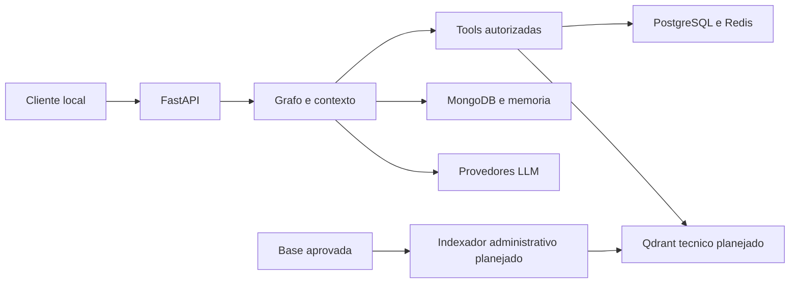

# Threat model — Trimmy e diagnóstico planejado

## Executive summary

Revisão estática em 2026-10-11. A API está somente local, confirmado pelo usuário. Os principais riscos são identidade simulada, ampliação acidental da autorização ao consultar justificativas, interpretação indevida de relatos e uso de regras não aprovadas. Os controles de diagnóstico são planejados, ainda não implementados. A revisão não certifica produção nem valida conexões reais.

## Scope and assumptions

- Escopo: app/, base técnica e implementação planejada de diagnóstico; Assessor apenas como referência arquitetural.
- Uso confirmado: chat de apoio a ocorrências de temperatura, acesso local atual, contrato futuro com mobile.
- Política aprovada: quatro perfis; SUPER_ADMIN global e demais por CD; alertas seguem integralmente o monitoramento, inclusive nível do OPERADOR.
- Fora do escopo: implantação do mobile, implementação de autenticação real, alterações nos planos dos serviços, reparos e automação operacional.
- Banco e cluster não auditados. Permissões de credenciais, rede privada, TLS na implantação e sensibilidade administrativa dos relatos não foram confirmados.
- A exposição externa mudaria significativamente a prioridade da identidade simulada; exige nova avaliação antes da publicação.

## System model

### Primary components

FastAPI oferece POST /chat e /chat/encerrar (`app/routes/chat.py:17,23`). LangGraph roteia, executa especialista e entrega resposta (`app/graph.py:156`). PostgreSQL autoriza e fornece dados operacionais (`app/tools/access.py:17`, `app/tools/monitoramento.py:45,161`); Redis fornece última leitura (`app/tools/monitoramento.py:95`). MongoDB persiste conversas (`app/memory.py:62`). Qdrant armazena resumos (`app/vectorstore.py:52,66`). Gemini/Groq processam mensagens (`app/llms.py:9`). Regras técnicas e indexador são adições planejadas.

### Data flows and trust boundaries

- Cliente local → FastAPI: JSON com token e mensagem via HTTP local; schema rejeita extras (`app/schemas.py:6`). Token não é validado (`app/auth.py:13`).
- Grafo → tools: chamadas internas controladas pelo modelo; identidade vem de ContextVar e é restaurada no finally (`app/tools/contexto.py:25`, `app/graph.py:196`). Autorização deve permanecer no backend.
- Tools → PostgreSQL/Redis: dados da câmara/alerta cruzam a fronteira da aplicação; SQL usa parâmetros e filtros de escopo (`app/tools/monitoramento.py:79,202`). Rede e privilégios dos serviços não auditados.
- Grafo/memória → MongoDB/Qdrant: conversa e resumos por usuário; Qdrant usa filtro e checagem adicional (`app/vectorstore.py:66`). Diagnóstico terá coleção técnica separada, sem conversas pessoais.
- Aplicação → provedores LLM/embeddings: textos e contextos via SDKs (`app/llms.py:9`, `app/vectorstore.py:21`). Minimizar campos enviados; não enviar token ou credenciais. Provedores externos continuam existindo mesmo com API local.
- Repositório → indexador → Qdrant técnico, planejado: aprovação humana e conteúdo versionado; comando administrativo fora do grafo.
- CI → dependências/testes: instalação pelo workflow `.github/workflows/pr-test.yml`; separado do atendimento em runtime. Integrações reais permanecem opt-in.

#### Diagram

## Assets and security objectives

| Asset | Why it matters | Security objective (C/I/A) |
| --- | --- | --- |
| Dados e justificativas por câmara/CD | Evitar acesso indevido e associação à ocorrência errada | C/I |
| Regras, fontes e aprovação | Impedir recomendação técnica não autorizada | I |
| Conversas e resumos pessoais | Evitar vazamento e contaminação de contexto | C/I |
| Credenciais dos serviços | Impedir acesso fora das consultas da aplicação | C |
| Disponibilidade e recursos de inferência | Evitar atendimento lento e consumo indevido | A |

## Attacker model

### Capabilities

Um cliente que consiga alcançar a API local pode enviar mensagens e tokens arbitrários, tentar manipular argumentos de tools por prompt e encerrar a sessão do usuário sintético. Conteúdo persistido originado de pessoas pode conter instruções indevidas. Um ator com acesso de escrita ao índice pode adulterar payloads; essa capacidade é uma condição, não acesso público comprovado.

### Non-capabilities

Não presumir que a API está pública, que mensagens dão acesso ao sistema operacional, que o usuário escreve SQL ou regras pelo chat, ou que o atacante controla PostgreSQL/Qdrant. Não presumir controles do proxy ou credenciais read-only sem verificar.

## Entry points and attack surfaces

| Surface | How reached | Trust boundary | Notes | Evidence |
| --- | --- | --- | --- | --- |
| Chat | POST /chat | Cliente/aplicação | Token recebido, identidade simulada | app/routes/chat.py:23; app/auth.py:13 |
| Encerramento | POST /chat/encerrar | Cliente/persistência | Resume e indexa conversa do usuário sintético | app/routes/chat.py:17; app/memory.py:85 |
| Conteúdo recuperado | Histórico e futura justificativa | Persistência/modelo | Relatos e memória não são instruções | app/graph.py:56; docs/base_tecnica_diagnostico_em_revisao.md:95 |
| Tools de diagnóstico | Chamadas do especialista planejado | Modelo/backend | Exigir autorização de câmara e alerta | app/tools/monitoramento.py:161 |
| Indexação técnica | Comando administrativo planejado | Operador/índice | Nunca expor em TOOLS ou endpoint | app/vectorstore.py:52 como referência, não indexador técnico existente |
| Provedores | Invocações e embeddings | Aplicação/terceiros | Enviar somente dados necessários | app/llms.py:9; app/vectorstore.py:21 |

## Top abuse paths

1. Alcançar API local → enviar token qualquer → operar como usuário 2 → consultar/persistir/encerrar sua conversa.
2. Induzir seleção de ID de alerta → nova consulta omitir um filtro do monitoramento → recuperar justificativa não permitida → vazamento no diagnóstico.
3. Escrever instrução em mensagem ou relato → modelo interpretá-la como requisito satisfeito → gerar hipótese inadequada → influenciar decisão humana.
4. Alterar payload técnico, quando houver acesso ao índice → regra indicar aprovação fictícia → recuperação confiar só no payload → recomendação não aprovada.
5. Repetir pedidos ou provocar chamadas extensas → consumir inferência/leituras → atraso no chat; ou causar falha de serviço → modelo responder como se não houvesse dados.

## Threat model table

| Threat ID | Threat source | Prerequisites | Threat action | Impact | Impacted assets | Existing controls (evidence) | Gaps | Recommended mitigations | Detection ideas | Likelihood | Impact severity | Priority |
| --- | --- | --- | --- | --- | --- | --- | --- | --- | --- | --- | --- | --- |
| TM-001 | Cliente local | Alcançar API | Token arbitrário opera como usuário 2 | Confusão de identidade e sessão | Conversas/dados | Restrição local confirmada; app/auth.py:13 | Autenticação simulada | Manter local; autenticação real antes de publicação | Identificar modo mock na inicialização, sem token em logs | low: acesso restrito | high: identidade comprometida se alcançada | medium |
| TM-002 | Mensagem/seleção manipulada | Consulta nova omitir filtro | Selecionar alerta fora do escopo | Exposição indevida | Justificativas | SQL parametrizado e filtros em app/tools/monitoramento.py:161 | Plano não explicita nível do operador | Reutilizar consulta completa e vínculo autorizado antes de justificativa | Testes de CD, nível e reconhecedor; logs mínimos de negação | medium: risco de implementação | high: isolamento de dados | high |
| TM-003 | Relato, memória ou usuário | Modelo interpretar conteúdo indevidamente | Instrução ou negação vira fato técnico | Hipótese/recomendação errada | Integridade da análise | Mensagens não viram SystemMessage, app/graph.py:56 | Citação e schema não validam significado | Referências da execução, requisitos por regra, dúvida pede confirmação, apresentação fixa | Casos adversariais e registro de regra/versão aplicada sem relato bruto | medium: risco semântico real | high: decisão humana afetada | high |
| TM-004 | Escritor do índice | Acesso de escrita ao Qdrant técnico | Payload adulterado declara aprovação | Uso de regra indevida | Base técnica | Cliente e coleção de memória separados, app/vectorstore.py:7 | Controles técnicos ainda planejados | Coleção exclusiva; conferir conteúdo aprovado; indexador fora do LLM | Falhas de versão/conteúdo; revisão da base | low: exige acesso específico | high: integridade técnica | medium |
| TM-005 | Cliente ou serviço lento | Chamadas repetidas/extensas ou indisponibilidade | Consumir recursos ou mascarar falha | Atraso, custo ou diagnóstico incorreto | Disponibilidade/dados | Limite de mensagem, app/schemas.py:14; Redis traduz falha, monitoramento.py:119 | Limites explícitos LLM não definidos; erros heterogêneos | Erros específicos e resposta genérica; avaliar limites antes de publicar sem inventar valores | Latência e tipo de erro, sem credenciais | medium: falhas externas plausíveis | medium: indisponibilidade local | medium |

## Criticality calibration

- critical: exposição pública com credenciais privilegiadas comprometidas; escrita operacional perigosa sem autorização. Não demonstradas aqui.
- high: leitura entre CDs; recomendação técnica adulterada capaz de afetar decisão humana.
- medium: identidade mock em ambiente local; indisponibilidade ou custos limitados de teste.
- low: dado técnico não sensível exposto apenas localmente; diferença documental sem ativação executável.

## Focus paths for security review

| Path | Why it matters | Related Threat IDs |
| --- | --- | --- |
| app/auth.py, app/main.py | Identidade simulada e futura fronteira de autenticação | TM-001 |
| app/tools/monitoramento.py, app/tools/access.py | Política única de câmara/alerta, incluindo operador | TM-002 |
| app/tools/diagnostico.py, planejado | Associação de evidências e justificativas | TM-002, TM-003 |
| app/graph.py, app/prompts.py | Instruções, saída estruturada e apresentação final | TM-003 |
| app/vectorstore.py, base estruturada e indexador planejados | Aprovação e integridade da recuperação | TM-004 |
| app/llms.py, app/memory.py, app/routes/chat.py | Disponibilidade, persistência e erros | TM-001, TM-005 |

## Notes on use

Confirmação de contexto obtida antes deste relatório: API somente local. Nenhuma exposição pública presumida; runtime separado de CI e indexação administrativa. Todos os dois endpoints e as fronteiras operacionais, persistência, provedores e índice planejado foram considerados. Schema implantado, controles da rede, privilégios dos bancos e política de envio de relatos a terceiros permanecem não verificados. Usar em conjunto com security_best_practices_report.md; riscos de diagnóstico são critérios para implementação, não vulnerabilidades já demonstradas de código inexistente.
