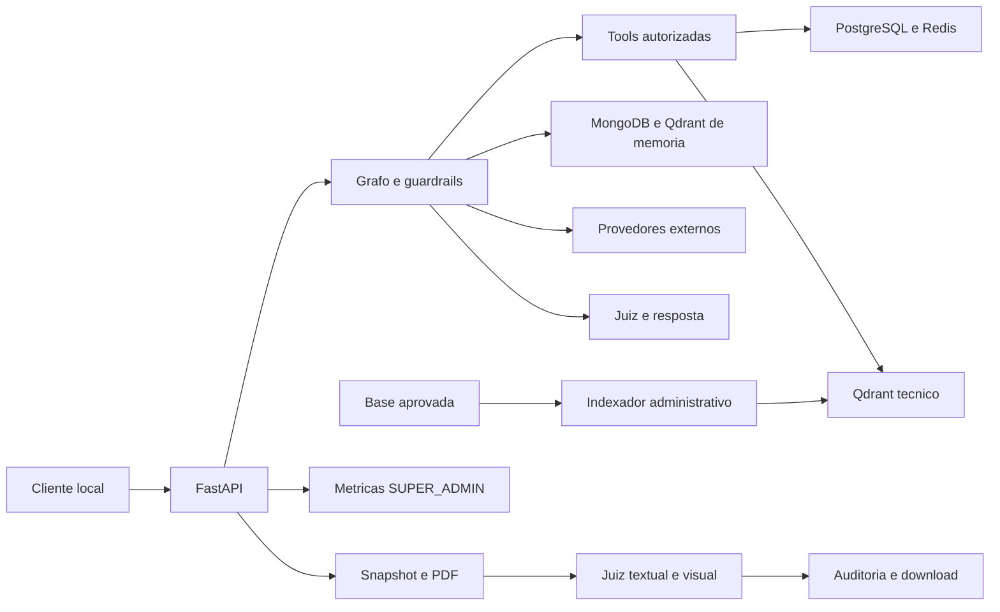

# Threat model — Trimmy

## Executive summary

API local com dados de teste, conforme confirmado pelo usuário. As fronteiras de
maior interesse são identidade mockada, autorização das tools, envio a provedores,
RAG/memória, validação de respostas/PDFs e persistência de conversas/métricas.
Não há evidência de RCE ou escrita operacional por instrução de chat. Publicação
com o mock mudaria o risco de identidade para alto e requer autenticação real.

## Scope and assumptions

- Escopo: `app/`, bases aprovadas, indexador, testes e workflows deste repositório.
- Assessor é referência de estrutura; suas regras financeiras são excluídas.
- Confirmado: somente local, bancos de teste e consumo futuro direto pelo mobile.
- Provedores podem receber dados/justificativas de teste permitidos, conforme
  autorização já fornecida. Credenciais e conteúdo pessoal reconhecido são protegidos.
- Fora: alterar mobile/backend principal, redes e permissões dos serviços,
  contratação, autenticação real, novas regras e automação física.
- Em aberto: política de sessões longas, consumidor MCP/A2A, publicação futura
  e premissas financeiras reais. Não foram presumidas aprovações nesses pontos.

## System model

### Primary components

FastAPI (`app/main.py`) recebe chat, encerramento, PDF e observabilidade. O grafo
(`app/graph.py`, `construir_fluxo`) usa roteador, especialistas, orquestrador,
guardrails e juiz. `tools/` contém schemas, identidade interna e consultas
compartilhadas. `llms.py` reutiliza Gemini/Groq. A geração de PDF é determinística;
seus juízes usam LLM. MongoDB conserva sessões e telemetria; Qdrant separa memória
e regras técnicas (`vectorstore.py`, `regras_diagnostico.py`).

### Data flows and trust boundaries

- Cliente local → FastAPI: HTTP, token/mensagem/filtros. Pydantic rejeita extras;
  autenticação é mock, autorização continua no backend (`auth.py`, `schemas.py`).
- Grafo → tools → PostgreSQL/Redis: filtros e dados operacionais. ContextVar
  fornece identidade, SQL parametrizado aplica perfil/CD e filtros de alerta
  (`tools/contexto.py`, `tools/access.py`, `tools/monitoramento.py`).
- Aplicação → MongoDB/Qdrant: mensagens, resumos e métricas; isolamento por usuário
  na memória, índice único parcial de sessão, coleções separadas. Protocolos e
  garantias de rede dependem das URLs configuradas, não foram auditados no cluster.
- Aplicação → provedores: perguntas, evidências permitidas, regras, PDF/imagens.
  SDKs, schemas e máscaras. Provedores não possuem tools administrativas ou acesso
  direto aos bancos. Cotas/latência não são controladas pela aplicação.
- Base local → indexador → Qdrant técnico: IDs, versão e assinatura aprovados;
  escrita administrativa separada das tools (`scripts/indexar_regras_diagnostico.py`).
- Snapshot → PDF → juiz → auditoria: dados consultados uma vez, validação de todas
  as páginas, bytes finais com hash e transação antes do download (`relatorios.py`).
- CI → dependências/testes/build: instalação do manifesto, Ruff e pytest;
  integrações reais opt-in, sem dependência de segredos em testes unitários.

#### Diagram

## Assets and security objectives

| Asset | Why it matters | Security objective |
| --- | --- | --- |
| Identidade, CD e perfis | Impedir acesso cruzado | C/I |
| Leituras, limites, alertas e justificativas | Respostas fiéis, sem diagnóstico mecânico inventado | C/I |
| Conversas e resumos | Separação entre usuários e contexto correto | C/I/A |
| Base aprovada e assinatura | Impedir ativação de regras adulteradas | I |
| Credenciais | Acesso aos bancos/provedores | C |
| PDF, hash e auditoria | Não entregar arquivo diferente do aprovado | I |
| Cota e telemetria | Atendimento e medição corretos | A/I |

## Attacker model

### Capabilities

Um cliente que alcance a API local pode enviar texto, token, headers e filtros.
Conteúdo persistido de origem humana pode conter instruções maliciosas. Um
operador com credencial de escrita no índice pode alterar payloads externos.

### Non-capabilities

Não se presume acesso remoto público, domínio do servidor, controle do código,
permissão para escrever no PostgreSQL ou controle das contas dos provedores.
Possuir um ID não concede autorização. A API não expõe execução de código,
uploads, reparos ou alteração de leituras/alertas por tools.

## Entry points and attack surfaces

| Surface | How reached | Trust boundary | Notes | Evidence |
| --- | --- | --- | --- | --- |
| POST /chat | JSON | Cliente/API | Texto não confiável; mock e guardrails | `routes/chat.py`, `graph.py` |
| POST /chat/encerrar | JSON | Cliente/memória | Resumo e indexação; sessão concorrente | `memory.py` |
| POST /relatorios/pdf | JSON | Cliente/snapshot/LLM | Gestor ou super admin, datas e câmara | `routes/relatorios.py`, `relatorios.py` |
| GET /observabilidade | Bearer | Cliente/telemetria | Somente SUPER_ADMIN | `routes/observabilidade.py` |
| Justificativas e resumos | Dados consultados | Banco/modelo | Dados, nunca instruções ou permissões | `tools/diagnostico.py`, `tools/memoria.py` |
| Indexação técnica | CLI local | Repositório/Qdrant | Fora de TOOLS | `regras_diagnostico.py` |
| SDKs e bibliotecas PDF | Chamada interna | Aplicação/provedor/parser | Quotas, erros e pacotes | `juiz.py`, `llms.py`, `pyproject.toml` |

## Top abuse paths

1. Alcançar o mock local → usar identidade compartilhada → acessar conversa ou
   recursos dessa identidade. Não é impedido pelo guardrail; bloqueia publicação.
2. Enviar outro CD/câmara → tentar consulta cruzada → SQL/autorização deve negar
   ou retornar seleção não encontrada, sem ampliar filtros.
3. Inserir instrução em mensagem/justificativa/resumo → tentar inventar causa ou
   permissão → validações determinísticas, fontes e juiz reduzem o risco.
4. Adulterar payload técnico → tentar ativar regra → assinatura/conteúdo local
   devem rejeitar versão diferente, pendente ou inativa.
5. Repetir chamadas extensas → esgotar cota ou acumular sessão → indisponibilidade;
   timeouts e validação não substituem política de volume/retenção.
6. Obter PDF não aprovado ou adulterado → tentar auditoria de bytes diferentes →
   serviço registra somente bytes finais aprovados e faz rollback em falha.

## Threat model table

| Threat ID | Threat source | Prerequisites | Threat action | Impact | Impacted assets | Existing controls | Gaps | Recommended mitigations | Detection ideas | Likelihood | Impact severity | Priority |
| --- | --- | --- | --- | --- | --- | --- | --- | --- | --- | --- | --- | --- |
| TM-001 | Cliente local | Alcançar API mockada | Compartilhar identidade | Dados da identidade expostos | Identidade/memória | Perfil/CD no backend; `auth.py` | Token não validado, intencional | Manter local; autenticar antes de publicar | Logs de acesso sem tokens | medium | medium | medium |
| TM-002 | Cliente/modelo | Informar filtro fora do acesso | Consultar outro CD/alerta | Exposição cruzada | Dados operacionais | `tools/access.py`, SQL e vínculo de justificativa | Permissões do serviço DB não auditadas | Preservar filtros e testar todos os perfis | Casos 403 e seleção inexistente | low | high | medium |
| TM-003 | Conteúdo não confiável | Mensagem ou texto persistido | Injetar instrução/causa | Resposta incorreta | Regras e decisões | Guardrails, Pydantic, fontes e `validar_analise` | Semântica parcial | Avaliação controlada e revisão humana | Reprovações por critério | medium | medium | medium |
| TM-004 | Escritor no índice | Credencial Qdrant | Alterar regra ou resumos | Conteúdo indevido | Base/memória | Assinatura local e filtro usuário | Privilégios do cluster desconhecidos | Restringir credenciais fora do app | Falhas de assinatura/versão | low | medium | low |
| TM-005 | Cliente ou falha externa | Chamadas grandes/repetidas | Esgotar cota/tempo/tamanho | Interrupção | Disponibilidade/conversas | Timeouts, passos limitados, PDF por página | Retenção e limites globais pendentes | Aprovar políticas; monitorar cotas | 413/429, latência e erros | medium | medium | medium |
| TM-006 | Cliente/defeito de geração | Solicitar PDF | Entregar dados/PDF divergentes | Relatório incorreto | PDF/auditoria | Snapshot, juiz, SHA-256 e rollback | Juiz pode errar semanticamente | Testes numéricos, visual e homologação real | Veredito e hash sem conteúdo | low | medium | low |

## Criticality calibration

- critical: RCE pré-autenticação ou controle remoto da infraestrutura; não
  demonstrados. Não classificar toda falha de modelo como crítica.
- high: publicação com mock ou leitura cruzada de dados reais; dependem de
  exposição/sensibilidade diferentes das confirmadas.
- medium: indisponibilidade por cotas, mistura de contexto ou resposta técnica
  indevida no ambiente de teste; exigem correção/homologação.
- low: erro cosmético ou payload externo adulterado já rejeitado, sem impacto
  operacional comprovado.

## Focus paths for security review

| Path | Why it matters | Related Threat IDs |
| --- | --- | --- |
| `app/auth.py`, `app/config.py` | Mock e segredos | TM-001 |
| `app/tools/` | Identidade e escopo nas consultas | TM-002 |
| `app/diagnostico.py`, `app/guardrail.py` | Relatos e validação | TM-003 |
| `app/regras_diagnostico.py`, `app/vectorstore.py` | Aprovação e isolamento | TM-004 |
| `app/llms.py`, `app/juiz.py`, `app/memory.py` | Cotas, formato e tamanho | TM-005 |
| `app/relatorios.py`, `app/pdf_relatorio.py` | Fidelidade e auditoria | TM-006 |
| `app/observabilidade.py`, `app/routes/observabilidade.py` | Métricas e acesso administrativo | TM-001, TM-005 |

## Notes on use

Entradas e fronteiras descobertas estão cobertas acima; runtime é separado de
CI/testes/CLI. Foram reutilizadas as confirmações anteriores de API local e dados
de teste, sem nova aprovação desnecessária. Não foram alterados perfis, schema,
triggers ou planos externos. Resultados reais e pendências ficam no acompanhamento
e no checklist em `TRIMMY.md`. Reavaliar antes de exposição externa.
