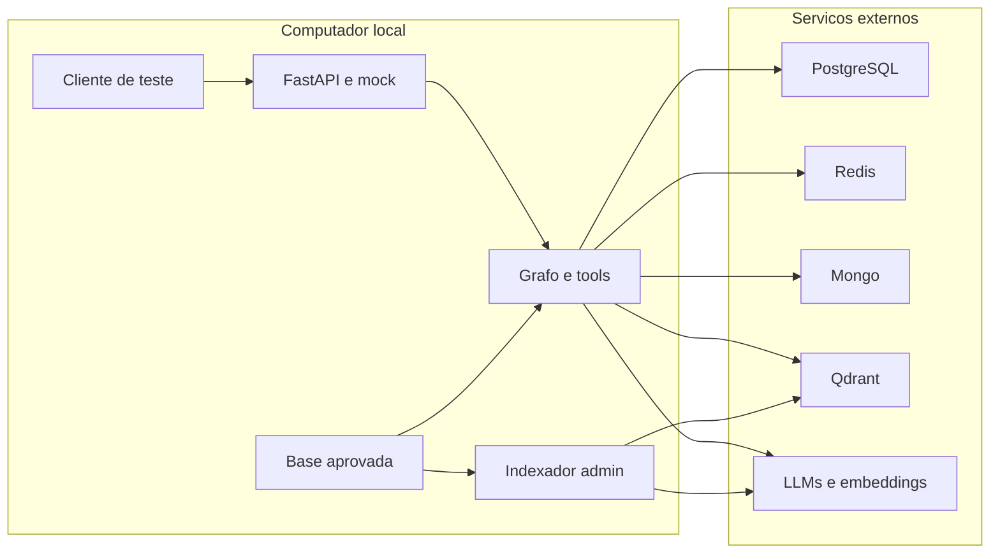

# Threat model — Trimmy (2026-10-12)

## Executive summary

A API está somente em localhost e usa exclusivamente dados de teste, confirmado
pelo usuário antes deste relatório. Os controles de escopo SQL, identidade interna
e regras locais aprovadas já existem. Os riscos atuais mais relevantes são
interpretação de relatos sem observação correspondente, conteúdo livre do modelo
fora do diagnóstico, disponibilidade por crescimento da memória e inconsistência
de sessão. O bypass de autenticação é conhecido e autorizado para testes, mas
impede exposição externa. Nenhum achado crítico remoto foi demonstrado no contexto atual.

## Scope and assumptions

- Escopo: app, scripts, base JSON, manifests, testes, CI e documentação do checkout.
- API local, sem túnel ou publicação; bancos com somente dados de teste: confirmados.
- Mock user 2 permanece intencional; todos os clientes locais usam essa identidade.
- Assessor é apenas referência arquitetural; regras financeiras, mobile e login real excluídos.
- Provedores/cluster, permissões das credenciais e segurança do sistema operacional
  não auditados. Nenhum segredo ou URI com credenciais incluído.
- PDFs de apoio inventariados, mas seu conteúdo técnico não revalidado nesta etapa.
- Perguntas de contexto foram respondidas. Exposição futura, dados reais e retenção
  ainda exigem nova avaliação; não presumir que este relatório valide produção.
- Relatórios anteriores foram preservados; este trata os controles implementados.

## System model

### Primary components

FastAPI expõe chat/encerramento em app/routes/chat.py. app/auth.py retorna user 2.
app/graph.py mantém grafo compilado, roteia e invoca especialistas; seus clientes
vêm de app/llms.py. Tools consultam PostgreSQL/Redis usando identidade ContextVar.
Diagnóstico reúne justificativas e valida proposta contra evidências e base local.
Mongo mantém sessões; Qdrant separa resumos pessoais e regras técnicas. Indexação
técnica só é acionada pelo script administrativo. Evidências: app/graph.py,
app/tools/diagnostico.py, app/regras_diagnostico.py, scripts/indexar_regras_diagnostico.py.

### Data flows and trust boundaries

- Cliente local → FastAPI: token/mensagem em HTTP JSON; schemas rejeitam extras,
  limitam tamanho de campos e validam tipos. Token não autentica atualmente.
  Evidência: app/routes/chat.py, app/schemas.py, app/auth.py.
- FastAPI → grafo/tools: identidade interna via ContextVar, restaurada em finally.
  Tools não recebem usuário/permissões do modelo. Evidência: app/graph.py:195–218,
  app/tools/contexto.py.
- Tools → PostgreSQL/Redis: SQL parametrizado/CD/alertas e seleção de sensores;
  conexão definida pelo operador no env. Transporte depende da configuração/SDK,
  não foi auditado em infraestrutura. Evidência: tools/access.py, tools/monitoramento.py.
- Grafo → LLM externo: mensagens, contexto, evidências/relatos e schemas; SDK usa
  chave de serviço. Saída é não confiável. Diagnóstico valida referências e valores,
  mas significado de observações ainda depende do modelo. Evidência: app/diagnostico.py.
- Grafo → Mongo: cria/reutiliza sessão e persiste pergunta/resposta; limite lógico
  de uma sessão ativa por usuário por índice parcial. Evidência: app/memory.py.
- Memória → Qdrant: embeddings/resumos com filtro usuarioId e conferência de payload.
  O helper de leitura também garante coleção/índice. Evidência: app/vectorstore.py.
- Diagnóstico → Qdrant/base local: recupera somente payload igual à versão aprovada
  local e assinatura/hash; pontuação não é confiança. Evidência: app/regras_diagnostico.py.
- Operador → script/base/CI: arquivos e env são controle administrativo, não conteúdo
  do chat. CI instala dependências e publica build; permissões e artefatos são
  fronteiras distintas do runtime. Evidência: pyproject.toml, .github/workflows.

#### Diagram

## Assets and security objectives

| Asset | Why it matters | Security objective (C/I/A) |
| --- | --- | --- |
| Leituras, limites, alertas e justificativas de teste | Contexto correto de câmara/ocorrência e escopo | C/I |
| Conversas e resumos | Identidade, continuidade e vínculo entre turnos | C/I/A |
| Regras aprovadas e versão local | Evitar hipóteses/recomendações não aprovadas | I |
| Chaves e credenciais de serviços | Acesso administrativo e custo/cotas | C |
| Disponibilidade da API e cotas | Testes e consumo futuro do mobile | A |
| Fonte, dependências e artefato | Código executado deve representar a versão revisada | I/A |

## Attacker model

### Capabilities

Um consumidor local consegue enviar mensagens arbitrárias, fazer chamadas repetidas
e fornecer textos que tentem induzir o modelo. Conteúdo de justificativa ou memória
pode conter instruções não confiáveis se um autor desses registros existir.
Modelos podem errar mesmo sem atacante. Um mantenedor/dependência comprometidos
pertencem a outra fronteira, não ao poder do consumidor do chat.

### Non-capabilities

Não presumir acesso remoto pela internet, gravação direta nos bancos, alteração
de .env/base local, leitura de chaves, controle do cluster ou bypass da query SQL.
O LLM não tem shell, SQL livre, indexação técnica ou tools de reparo. Redis pode
ser global para o backend, mas somente os sensores autorizados saem das consultas.
Ausência de controle observado não prova exploração realizada.

## Entry points and attack surfaces

| Surface | How reached | Trust boundary | Notes | Evidence |
| --- | --- | --- | --- | --- |
| POST /chat | Cliente local | HTTP → modelo/tools | Mock e persistência; resposta técnica/formato | routes/chat.py:21–41 |
| POST /chat/encerrar | Cliente local | HTTP → memória/LLM/Qdrant | Resumo e fechamento modificam estado de sessão | routes/chat.py:16–19, memory.py:86 |
| Docs/OpenAPI | HTTP local | Cliente → contrato | Úteis no teste; não achado de exposição pública atual | main.py:22–26 |
| Mensagens/histórico/justificativas | Chat ou dados persistidos | Dados → interpretação pelo LLM | Prompt injection e rótulos sem sustentação | diagnostico.py:151–172, graph.py:50 |
| Resumos e regras recuperados | Qdrant | Payload externo → contexto/base | Usuário filtrado; base técnica comparada localmente | vectorstore.py:67, regras_diagnostico.py:114 |
| Base e indexador | Operador local | Arquivo → índice técnico | Não acessível ao LLM | scripts/indexar_regras_diagnostico.py |
| Build/dependências | GitHub Actions/instalação | Pacotes/CI → execução | Manifests divergentes e pacote stub | pyproject.toml, workflows/build.yml |

## Top abuse paths

1. Identidade compartilhada: outro consumidor local alcança /chat → qualquer token
   válido como texto vira user 2 → lê/escreve contexto desse usuário. Com dados de
   teste o impacto é limitado; publicação futura mudaria o risco.
2. Hipótese indevida: texto sem observação é rotulado pelo modelo como
   vedacao_danificada → backend confere apenas presença literal e flags →
   aplica regra aprovada sem o requisito realmente expresso. Prova offline confirmada.
3. Indisponibilidade: várias interações alongam o array Mongo → cada turno volta
   a carregar documento inteiro e a repetir metadados → gravação/resumo ficam
   caros ou falham no tamanho BSON; buscas por sensor ausente percorrem Redis.
4. Contaminação por conteúdo: memória/justificativa/mensagem tenta impor resposta
   técnica → outros especialistas/orquestrador usam texto livre → podem apresentar
   afirmação sem dados. Prompts são barreira parcial; SQL por CD e base canônica
   continuam protegendo acesso e texto técnico do caminho validado.
5. Mudança de sessão durante turno: uma chamada local encerra a sessão enquanto
   outra aguarda o modelo → salvamentos readquirem a ativa → pergunta/resposta
   podem ir a sessão diferente da usada no contexto, inclusive separadas.
6. Cadeia de instalação: dependência/ambiente muda ou operador usa wheel gerado →
   build contém somente stub e faltam dependências declaradas → API não é
   reproduzível pelo artefato. Execução maliciosa por dependência é cenário
   condicional, não uma vulnerabilidade de pacote demonstrada.

## Threat model table

| Threat ID | Threat source | Prerequisites | Threat action | Impact | Impacted assets | Existing controls (evidence) | Gaps | Recommended mitigations | Detection ideas | Likelihood | Impact severity | Priority |
| --- | --- | --- | --- | --- | --- | --- | --- | --- | --- | --- | --- | --- |
| TM-001 | Consumidor local; futura exposição | Alcançar a API de teste | Usar qualquer token como user 2 | Memória compartilhada e operações com identidade fixa | Conversa/escopo | Mock explícito; SQL por CD (auth.py, monitoramento.py) | Sem autenticação real; estado duplicado | Centralizar mock; impedir publicação até login real | Aviso de modo de teste; testes de autenticação real futuramente | Baixa no contexto confirmado | Baixo com dados de teste; alto se reais | low |
| TM-002 | Modelo ou texto indutor | Proposta com referência legítima mas requisito incorreto | Rotular trecho genérico como observação | Hipótese sem evidência | Integridade diagnóstica | Enum, citação, limites, base canônica (diagnostico.py:151–181) | Significado/vínculo/atualidade ainda classificados pelo LLM | Rejeitar trecho sem observação e pedir esclarecimento; regressão do caso genérico | Avaliação de hipóteses descartadas sem logar relatos | Média, backend aceitou prova offline | Médio no teste; maior antes de uso real | medium |
| TM-003 | Consumidor repetitivo ou operação normal longa | Sessões/stream crescentes | Aumentar trabalho por chamada | Falha de armazenamento e cotas | API/Mongo/Redis/LLMs | Campos limitados; retry limitado (schemas.py, llms.py) | Array ilimitado, leitura integral, índices repetidos, orçamento técnico não explícito | Projeção, armazenamento aprovado, índices uma vez; limites medidos | Latência, tamanho de sessão, páginas do stream, falhas de cota | Baixa no teste pequeno | Médio | medium |
| TM-004 | Conteúdo não confiável/modelo | Mensagem, resumo ou justificativa interpretados | Induzir afirmações sem respaldo | Resposta inventada ou contexto enviesado | Integridade/conversa | Prompts, ContextVar, filtros, payload canônico (prompts.py, regras_diagnostico.py) | Outros domínios têm texto livre; FAQ/relatórios sem fontes/tools próprias | Não declarar domínios prontos; respostas de limitação e contratos verificáveis | Casos adversariais; conferir saída versus dados consultados | Média, falha possível não reproduzida com LLM nesta revisão | Médio | medium |
| TM-005 | Consumidor concorrente/fechamento normal | Turnos e encerramento sobrepostos | Mudar sessão entre leitura e escrita | Turno dividido e inconsistência | Conversas/resumos | Índice parcial e status (memory.py:26–100) | Turno não fixa sessão e escreve duas vezes | ID interno do turno e gravação atômica; decidir conflito | Teste de corrida; falhas de salvamento e IDs internos sem conteúdo | Baixa local | Médio | low |
| TM-006 | Ambiente/dependência/operador | Nova instalação/build; comprometimento adicional para abuso malicioso | Usar pacote divergente ou código externo alterado | Quebra de instalação; comprometimento condicional | Artefatos/credenciais/API | CI/Ruff/pytest; .env ignorado | Wheel stub, manifests divergentes, sem lock declarado | Alinhar pacote/deps e teste do artefato; revisar versões verificadas | Import smoke test do wheel e revisão de dependências | Baixa; configuração divergente comprovada | Médio; alto em comprometimento externo | medium |

## Criticality calibration

| Level | Calibração e exemplos condicionais |
| --- | --- |
| critical | Não demonstrado aqui: execução arbitrária pré-autenticação sobre dados reais; exfiltração de credenciais de todos os serviços por API publicada. |
| high | Publicar mock com dados reais; bypass comprovado de CD expondo outras unidades. Ambos fora do contexto atual ou não encontrados. |
| medium | Aplicar regra sem a observação exigida; perda de disponibilidade por crescimento da conversa; pacote que não representa o backend. |
| low | Mock intencional local com dados de teste; inconsistência de configuração/documentação sem exposição; fechamento não explicitado sem vazamento permanente medido. |

A prioridade depende principalmente de exposição e dados reais, ambos negados pelo
usuário nesta revisão. Não elevar localhost HTTP, docs locais ou falta de JWT
específico a achado crítico. Não confundir controles de prompt com autenticação.

## Focus paths for security review

| Path | Why it matters | Related Threat IDs |
| --- | --- | --- |
| app/auth.py e app/main.py | Identidade mock e erros públicos | TM-001 |
| app/tools/access.py | Autorização e ciclo de conexão | TM-001, TM-003 |
| app/tools/monitoramento.py | SQL/Redis/CD e filtros de alerta | TM-001, TM-003 |
| app/tools/diagnostico.py | Associação alerta/justificativa e snapshots | TM-002, TM-004 |
| app/diagnostico.py | Aplicabilidade e relatos | TM-002, TM-004 |
| app/memory.py e app/graph.py | Tamanho, contexto e consistência de turno | TM-003, TM-005 |
| app/vectorstore.py e app/regras_diagnostico.py | Fronteira com payloads e aprovações | TM-003, TM-004 |
| app/prompts.py e app/llms.py | Contratos e fallback, sem conceder acesso | TM-002, TM-004 |
| pyproject.toml e .github/workflows | Build e dependências | TM-006 |

## Notes on use

- Cobertos chat, encerramento, docs locais, indexador e CI.
- Fronteiras HTTP, SQL/Redis, memória/Qdrant, modelo, fonte local e build consideradas.
- Runtime separado de ferramentas administrativas, exemplos e testes.
- Contexto validado em duas perguntas ao usuário antes da redação.
- Ruff aprovado; 258 testes passaram; quatro integrações opt-in puladas.
- Provas offline de correspondência de relato e formatação não acessaram bancos.
- Nenhuma chamada a serviços reais, alteração de regras/dados, commit ou push.
- Não é comprovação de ausência de falhas nem certificação de produção.

